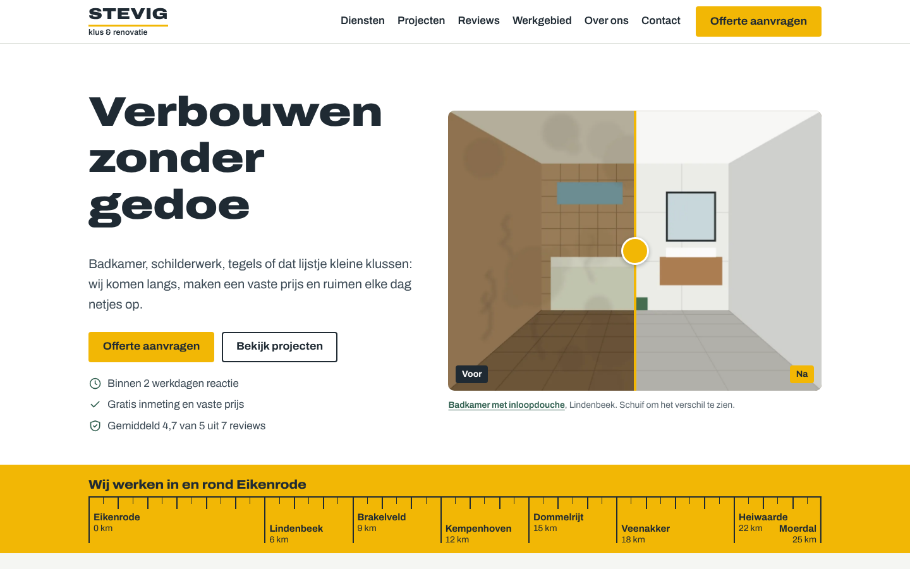
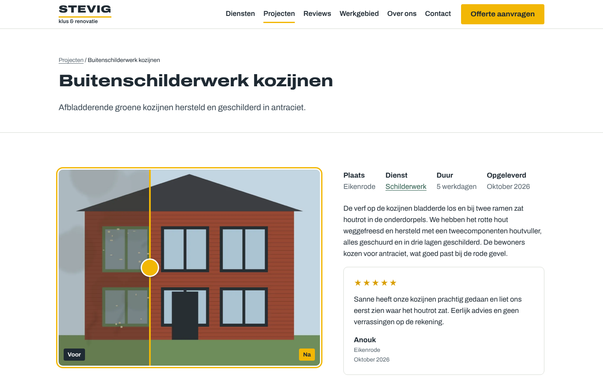
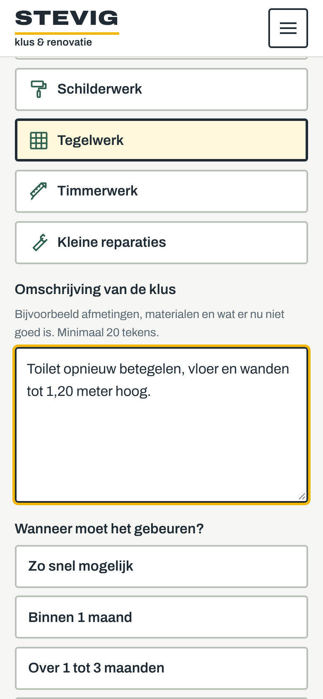
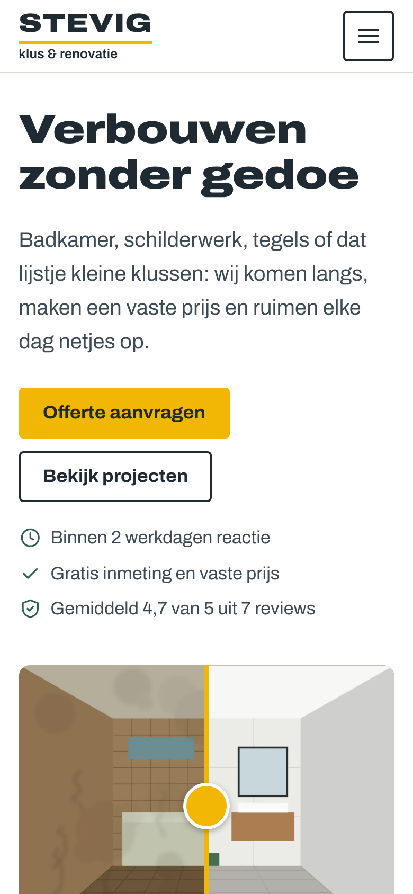
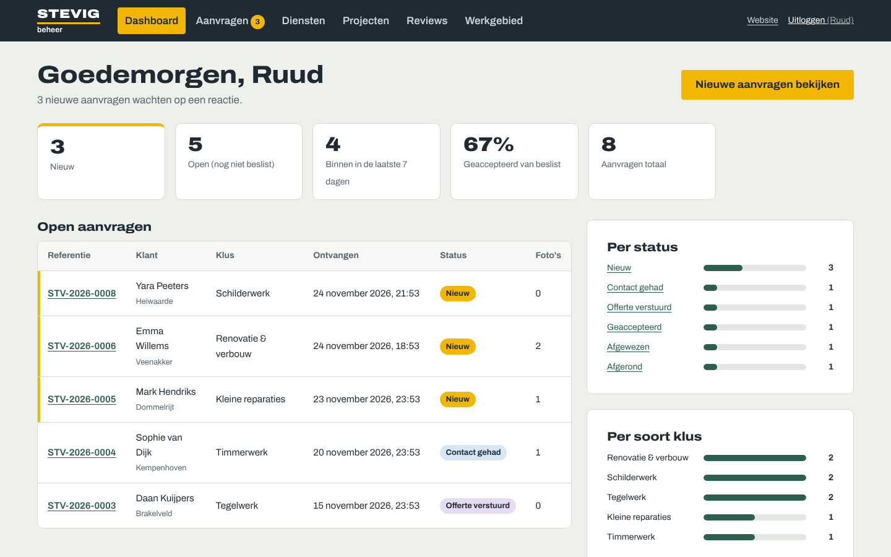
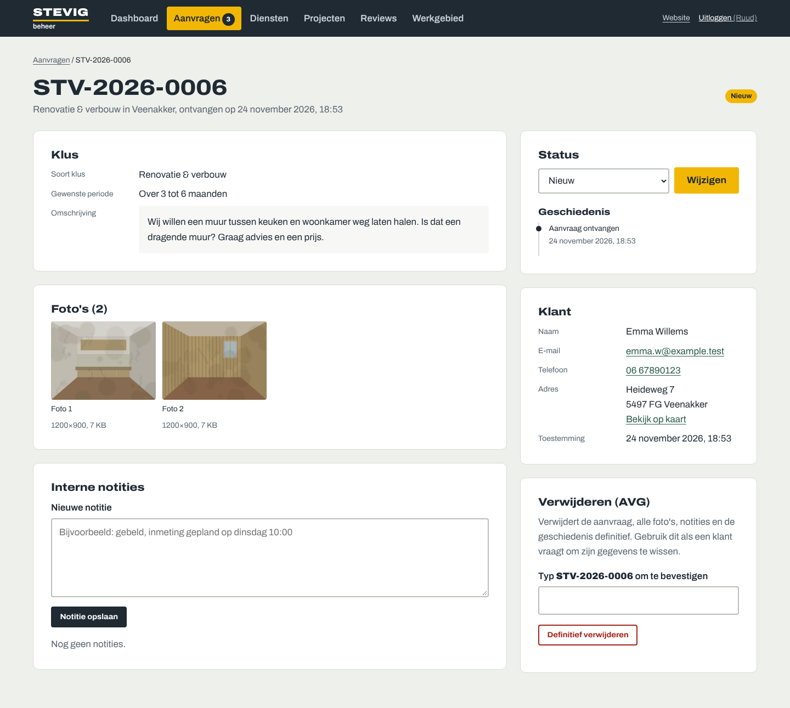

# Stevig Klus & Renovatie

A website for a fictional handyman and renovation company in the fictional town of Eikenrode (Noord-Brabant). The site is built around one goal: **getting quote requests**. Visitors can browse before/after projects, read reviews, check the service area and send a quote request with photos. The owner handles every request in a small admin panel.

Built from scratch in plain PHP and MySQL, without a framework, as a portfolio project with a strong focus on **secure file uploads** and web security.

> The company, people, towns, reviews and demo requests are all fictional. The project photos are generated illustrations.



## Features

### Public website (Dutch)
- Homepage with an interactive **before/after slider** of a featured project
- Services, about us, contact and a GDPR (AVG) privacy statement
- **Project gallery** with a service filter and detail pages (`/projecten/{slug}`) with before/after photos
- **Reviews** with an average rating
- **Service area** shown on a tape-measure ruler, with each town placed at its real distance
- **Quote request form**: contact details, address, type of job, description, preferred period and up to 5 photos, with drag and drop and previews
- Confirmation page with a reference number (`STV-2026-0042`), a **confirmation email** to the customer and a **notification email** to the company

### Admin panel (`/admin/`)
- Dashboard with new and open requests, requests from the last 7 days, acceptance rate, and requests per status and per service
- Request list with status and service filters, search and pagination
- Request detail with private photos, a status workflow (new → contacted → quote sent → accepted / rejected → done), an audit log of who changed what, internal notes and a GDPR delete action
- CRUD for services, projects (including before/after photo upload), reviews and the service area

## Tech stack

| Layer | Choice |
|---|---|
| Backend | PHP 8.2+ (no framework), PDO with native prepared statements |
| Database | MySQL / MariaDB (utf8mb4, InnoDB, foreign keys) |
| Frontend | Semantic HTML, mobile-first CSS, vanilla JavaScript |
| Images | GD (re-encode to WebP), fileinfo, EXIF |
| Mail | PHPMailer 6.9 (bundled), with a `log` driver for local development |
| Font | Archivo variable font, self-hosted (no Google Fonts) |
| Build | `npm run build` (esbuild) to minify CSS and JS |

## Security

| Threat | Measure |
|---|---|
| SQL injection | PDO prepared statements everywhere, `ATTR_EMULATE_PREPARES = false`, whitelists for sort values and enums, LIKE wildcards escaped |
| XSS | Every output goes through `htmlspecialchars` (`e()`); strict **Content Security Policy** with no inline JS or CSS (`script-src 'self'; style-src 'self'`) |
| CSRF | Token in every POST form, compared with `hash_equals`; logout is POST-only |
| Brute force | Login limited to 5 failed attempts per 15 minutes per IP; bcrypt (cost 12) plus a dummy hash with the same cost, so unknown emails take as long as wrong passwords |
| Session hijacking | `HttpOnly` and `SameSite=Lax` cookies (`Secure` on HTTPS), strict mode, ID regenerated on login, idle and absolute timeouts, user-agent binding |
| Spam | Honeypot field, a 3-second time trap (bots get a fake success page), rate limit of 5 requests per hour and 30 attempts per hour per IP |
| Privacy (GDPR) | IP addresses only stored as HMAC-SHA256 with a secret key and deleted after 24 hours; explicit consent with a timestamp; delete action for erasure requests; no third-party requests |
| Clickjacking and sniffing | `X-Frame-Options: DENY`, `frame-ancestors 'none'`, `X-Content-Type-Options: nosniff`, HSTS over HTTPS |
| Secrets | `.env` is outside Git (`.env.example` is committed); only `public/` is reachable from the web |

### Secure file upload

Uploading photos is the riskiest feature of the site, so every file goes through `src/ImageUpload.php`:

1. **Type by content, not by name.** `finfo` and `getimagesize` read the real bytes; the extension and the browser's MIME type are ignored because the attacker controls both. Only JPEG, PNG and WebP are allowed.
2. **Limits.** Max 5 files, 5 MB per file and 20 MB in total (all configurable). A minimum of 200 px and a maximum of 25 megapixels are checked *before* decoding, which blocks "decompression bombs" (a tiny file that expands to gigabytes in memory). Requests over `post_max_size` get a clear message instead of a broken form.
3. **Re-encode.** GD decodes the image, applies the EXIF orientation, scales it down to max 2000 px and writes a **new WebP file**. Only pixels are copied, so EXIF/GPS location, camera details and any payload appended to the file (polyglots) are gone.
4. **Random names.** Files are saved as `bin2hex(random_bytes(16)).webp`. The original name is never used in a path, which prevents guessing, overwriting and path traversal.
5. **Storage.**
   - Customer photos are private and stored in `storage/uploads/requests/`, outside the web root. They are only served by `admin/photo.php` after a login check, a filename whitelist and a `realpath` check.
   - Public project photos are stored in `public/uploads/projects/`, where `.htaccess` turns off PHP and blocks `.php`, `.html`, `.svg` and `.js` files.
6. **Transaction.** The request, its photos and the first status log entry are saved in one database transaction. If anything fails, the files that were already written are deleted again.

Tested with a PHP script renamed to `.jpg`, an SVG with `<script>` renamed to `.png`, a JPEG + PHP polyglot, a JPEG with GPS data and a 20,000 × 20,000 px PNG bomb.

## Screenshots

| Before/after project | Quote form (mobile) | Homepage (mobile) |
|---|---|---|
|  |  |  |

| Admin dashboard | Request detail |
|---|---|
|  |  |

## Run it locally (XAMPP)

Requirements: XAMPP with PHP 8.2 or newer. The `gd`, `exif`, `fileinfo`, `mbstring` and `pdo_mysql` extensions must be enabled in `php.ini` (they are by default in recent XAMPP versions).

1. Put the project in `C:\xampp\htdocs\klusbedrijf` and start **Apache** and **MySQL** in the XAMPP Control Panel.
2. Create the database. In phpMyAdmin, import these files in this order:
   1. `database/schema.sql` (creates the `stevig_klus` database and tables)
   2. `database/seed.sql` (services and service area)
   3. `database/demo.sql` (optional: demo projects, reviews and requests)

   Or from Command Prompt (cmd, not PowerShell) in the project folder:
   ```bash
   C:\xampp\mysql\bin\mysql -u root < database\schema.sql
   C:\xampp\mysql\bin\mysql -u root < database\seed.sql
   C:\xampp\mysql\bin\mysql -u root < database\demo.sql
   ```
3. Copy `.env.example` to `.env` and set a random `APP_KEY` (at least 32 characters):
   ```bash
   copy .env.example .env
   C:\xampp\php\php -r "echo bin2hex(random_bytes(32));"
   ```
4. Open http://localhost/klusbedrijf.
5. Open http://localhost/klusbedrijf/admin/ and create the first admin account. The setup page locks itself after that.

With `MAIL_DRIVER=log`, emails are not sent. They are saved as `.eml` files in `storage/mail/`, which you can open in Outlook or Thunderbird.

### Build (optional)

The minified files are committed, so a build is only needed after you change CSS or JS:

```bash
npm install
npm run build
```

With `APP_ENV=local`, the readable files are used. In any other environment, `asset()` serves the `.min` versions automatically.

## Project structure

```
klusbedrijf/
├── .htaccess              # sends every request to public/
├── database/              # schema.sql, seed.sql, demo.sql
├── docs/screenshots/
├── lib/PHPMailer/
├── public/                # the only folder reachable from the web
│   ├── .htaccess          # security headers, CSP, clean URLs
│   ├── admin/             # admin pages and the photo.php endpoint
│   ├── assets/            # css, js, fonts, icons
│   ├── uploads/projects/  # public project photos (no script execution)
│   └── *.php              # public pages
├── src/                   # classes: Auth, Csrf, ImageUpload, QuoteRequestService, ...
├── storage/
│   ├── mail/              # .eml files when MAIL_DRIVER=log
│   └── uploads/           # private customer photos and temporary files
└── templates/             # layout, partials, admin and email templates
```

## Demo mode

The public demo runs with `DEMO_MODE=true` in `.env`:

- A banner explains that Stevig is fictional and that data is reset automatically. Pages send `noindex`.
- Mail is never sent, even with `MAIL_DRIVER=smtp`. Messages are written to `storage/mail/` instead.
- Photo uploads are switched off in the quote form and in the admin, so nobody can put files on the server.
- The admin login shows the demo account from `DEMO_ADMIN_EMAIL` / `DEMO_ADMIN_PASSWORD`, and `/admin/setup.php` is disabled.
- `php scripts/reset-demo.php` rebuilds the database from `database/*.sql`, recreates the demo admin and removes every non-demo upload and stored mail. Run it with a cron job. It only runs from the command line and refuses to run without `DEMO_MODE=true`.

## Deploy a demo

To share a live link, a free PHP host such as **InfinityFree** works for a portfolio demo:

1. Create an account and a free subdomain, and turn on the free SSL certificate.
2. Upload the whole project into `htdocs/` with FTP (for example FileZilla). The root `.htaccess` makes sure only `public/` is reachable.
3. Create a MySQL database in the control panel and import the three SQL files with phpMyAdmin. Remove the `CREATE DATABASE` and `USE` lines from the files first, because the database name is fixed by the host.
4. Create a `.env` on the server with the database details, a new `APP_KEY`, `APP_URL=https://your-domain` and `APP_ENV=production`.
5. Visit `/admin/` right away to create the admin account.

Points to keep in mind:
- On InfinityFree, PHP upload limits are fixed and cannot be raised, and other files are limited to 10 MB ([InfinityFree forum](https://forum.infinityfree.com/t/file-size-and-upload-limits/49308)). Set `UPLOAD_MAX_TOTAL_MB` below the host's `post_max_size`.
- Free hosts usually block PHP `mail()`. For real emails, set `MAIL_DRIVER=smtp` with an SMTP service such as Brevo or Mailtrap (this also needs the `openssl` PHP extension), or keep `MAIL_DRIVER=log` for a demo.
- Never upload `node_modules/` or a `.env` with local passwords.

For a real customer, a paid host with SSH, automatic backups and a document root that can point directly to `public/` is a better choice.

## License

Portfolio project by Saleh Ahmed. PHPMailer is LGPL-2.1, and the Archivo font is licensed under the SIL Open Font License (`public/assets/fonts/OFL.txt`).
